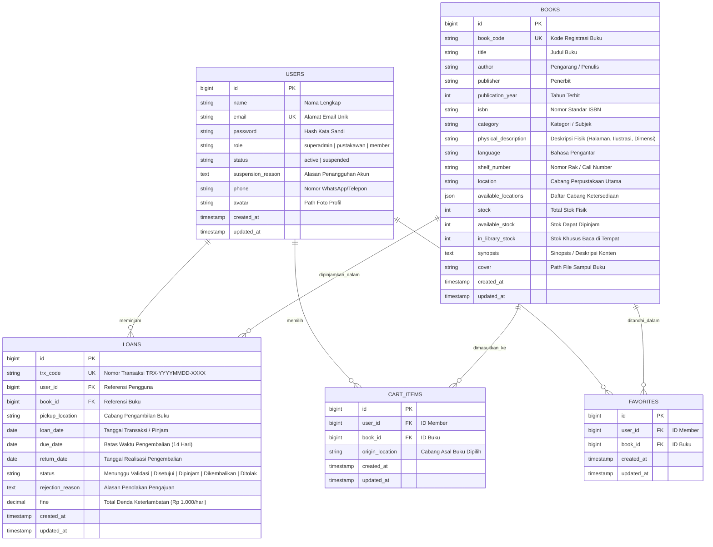
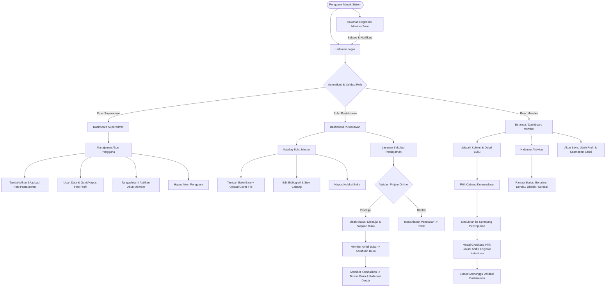

# DOKUMEN PERANCANGAN SISTEM (MILESTONE 1)
## DigiLib - Sistem Administrasi Perpustakaan Digital & Sirkulasi Terpadu

---

### 1. Informasi Proyek
* **Nama Aplikasi:** DigiLib (Academic Archive & Digital Circulation Management)
* **Kategori:** Sistem Informasi Manajemen Perpustakaan Terpadu (E-Library)
* **Target Pengguna:** 
  1. **Superadmin:** Pengelola tingkat sistem dan administrator akun.
  2. **Pustakawan:** Staf operasional pelayanan sirkulasi fisik & validasi online.
  3. **Member (Anggota Umum / Mahasiswa):** Pengguna layanan perpustakaan, peminjam buku fisik, dan reservasi online.
* **Tujuan:** Menyediakan antarmuka manajemen perpustakaan modern dengan arsitektur **Neumorphic Soft UI**, memfasilitasi alur peminjaman mandiri berbasis cabang pengambilan (mengadopsi alur modern reservasi perpustakaan), monitoring denda otomatis, pelacakan inventaris buku, serta pengawasan hak akses akun secara real-time.
* **Link Figma Design System & High-Fidelity UI:** [Figma Project - DigiLib UI Design System](https://www.figma.com/design/8enUtgdAB71gVU3fzmbVLN/Sistem-Perpustakaan-DigiLib?t=MsrbwjYF6Sfde4be-1)

---

### 2. Hierarki Menu & Navigasi Antarmuka Berdasarkan Peran (Role)

```
[DigiLib Multi-Role Application]
│
├── 🛡️ PORTAL SUPERADMIN (Admin Panel Utama)
│   ├── Topbar: Profil Superadmin, Avatar, Indikator Sistem
│   ├── 📊 Dashboard: Metrik Pertumbuhan Akun, Chart.js Pertumbuhan Member & Pustakawan, Donut Chart Rasio Akun
│   ├── 👥 Manajemen Akun:
│   │   ├── Tabel Akun Pengguna (Member, Pustakawan, Superadmin)
│   │   ├── Modal Tambah Akun (Upload Foto Profil Pustakawan, Dynamic Role)
│   │   ├── Modal Edit Akun (Pratinjau Avatar, Ganti Foto, Hapus Foto Profil Pustakawan)
│   │   ├── Modal Tangguhkan Akun (Preset Alasan & Input Custom Alasan Penangguhan)
│   │   ├── Modal Pulihkan / Aktifkan Kembali Akun
│   │   └── Modal Hapus Akun Pengguna
│   └── 🚪 Keluar (Modal Konfirmasi Logout)
│
├── 📖 PORTAL PUSTAKAWAN (Layanan Operasional Sirkulasi)
│   ├── Topbar: Profil Pustakawan, Avatar Sinkron, Quick Action Catat Peminjaman
│   ├── 📊 Dashboard Pustakawan:
│   │   ├── Stat Cards (Total Koleksi, Eksemplar Fisik, Peminjaman Berjalan, Denda)
│   │   └── Chart.js Tren Peminjaman & Buku Populer
│   ├── 📚 Katalog Buku:
│   │   ├── Inventaris Master Buku & Filter Kategori
│   │   ├── Modal Tambah Buku (Dropzone / Upload Sampul Lokal, Ketersediaan Cabang, Stok)
│   │   ├── Modal Ubah Data Buku (Ganti Sampul, Update Stok Baca di Tempat & Pinjam)
│   │   └── Modal Hapus Koleksi Buku
│   ├── 🔄 Layanan Sirkulasi (Peminjaman & Pengembalian):
│   │   ├── Tab Status (Semua, Validasi Online, Siap Diambil, Sedang Dipinjam, Selesai)
│   │   ├── Live Search Transaksi, Buku, dan Anggota
│   │   ├── Modal Setujui Pinjam Online & Modal Tolak dengan Keterangan Alasan
│   │   ├── Tombol Serahkan Buku di Meja Resepsionis
│   │   ├── Modal Konfirmasi Penerimaan Kembali Buku & Perhitungan Denda Otomatis (Rp 1.000/hari)
│   │   └── Modal Catat Peminjaman Offline Baru
│   ├── 👥 Data Anggota:
│   │   ├── Daftar Anggota & Status (Aktif / Ditangguhkan)
│   │   └── Modal Riwayat Peminjaman Spesifik per Anggota
│   └── 🚪 Keluar (Modal Konfirmasi Logout)
│
└── 👤 PORTAL MEMBER (Layanan Peminjaman Mandiri)
    ├── Banner Notifikasi Penangguhan Akun (jika akun ditangguhkan Superadmin)
    ├── 🏠 Beranda: Banner Selamat Datang, Quick Access Koleksi, Rekomendasi Buku Pilihan
    ├── 📚 Daftar Koleksi:
    │   ├── Filter Kategori & Live Search Judul / Penulis
    │   ├── Grid Kartu Buku Neumorphic
    │   ├── Tombol Favorit Cepat & Tombol Masuk Keranjang
    │   └── Modal Pilih Lokasi Ketersediaan Cabang Buku
    ├── 📖 Detail Buku:
    │   ├── Metadata Bibliografi (Penerbit, Tahun, Deskripsi Fisik, ISBN, Subjek, Bahasa, No. Rak/Call)
    │   ├── Badge Status Ketersediaan Cabang (Dapat Dipinjam, Baca di Tempat, Sedang Dipinjam)
    │   ├── Tombol Aksi Pinjam / Sudah di Keranjang
    │   └── Modal Bagikan Buku Interaktif (WhatsApp, X, Instagram, Salin Tautan)
    ├── 🛒 Keranjang Peminjaman:
    │   ├── Daftar Koleksi Terpilih per Cabang Asal
    │   ├── Modal Checkout Peminjaman (Pemilihan Lokasi Ambil, Metode Resepsionis, Checkbox Ketentuan)
    │   └── Tombol Hapus Buku dari Keranjang
    ├── ⭐ Buku Favorit: Daftar Simpan Buku untuk Dibaca Nanti
    ├── ⚡ Pinjam Online: Akses Cepat Peminjaman Digital & Pengambilan Mandiri
    ├── 📋 Aktivitas (Riwayat Sirkulasi):
    │   ├── Filter Status (Semua, Sedang Berjalan, Selesai Dikembalikan, Ditolak)
    │   └── Kartu Detail Transaksi (ID Trx, Lokasi Pengambilan, Tanggal Jatuh Tempo, Denda, Alasan Penolakan)
    ├── ⚙️ Akun Saya:
    │   ├── Pengaturan Data Pribadi & Kontak
    │   ├── Pengunggahan Foto Profil Member
    │   ├── Form Keamanan Kata Sandi (Password Toggle Visibility)
    │   └── Status Keanggotaan & Riwayat Sanksi
    └── 🚪 Keluar (Modal Konfirmasi Logout)
```

---

### 3. Entity Relationship Diagram (ER-D)

Sistem DigiLib dibangun di atas skema relasional yang menghubungkan manajemen identitas pengguna, inventaris buku, keranjang belanja peminjaman, wishlist favorit, dan sirkulasi peminjaman:



---

### 4. User Flow Antarmuka

Berikut adalah alur lengkap interaksi pengguna pada sistem DigiLib:



---

### 5. Design System & Style Guide (Neumorphic Soft UI)

#### 5.1 Color Palette
* **Background Primary (Base):** `#E6ECF5` (Soft Powder Neumorphic Canvas)
* **Background Surface / Card:** `#E9EFF8` / `#EAF0F9` (Raised Element Tint)
* **Primary Brand Blue:** `#2563EB` (Royal Blue) & `#1D4ED8` (Deep Blue Accent)
* **Success Emerald Green:** `#059669` / `#10B981` (Status Selesai, Terima Buku, Disetujui)
* **Danger Vibrant Red:** `#DC2626` / `#EF4444` (Status Ditolak, Hapus Akun, Banner Penangguhan)
* **Warning Amber:** `#F59E0B` (Menunggu Validasi Peminjaman)
* **Sky Info Blue:** `#0284C7` (Status Siap Diambil di Resepsionis)
* **Text Main (Primary Typography):** `#1E293B` (Dark Slate)
* **Text Muted:** `#64748B` (Neutral Secondary)
* **Text Contrast on Solid Buttons:** `#FFFFFF` (Wajib Putih Bersih di atas latar belakang solid)

#### 5.2 Neumorphic Elevation & Shadow Tokens
* **Soft Card Emboss (Dual Outer Shadow):** `6px 6px 14px rgba(166, 180, 200, 0.55), -6px -6px 14px rgba(255, 255, 255, 0.95)`
* **Pill Button Normal:** `4px 4px 10px rgba(166, 180, 200, 0.5), -4px -4px 10px rgba(255, 255, 255, 0.9)`
* **Pill Button Active / Pressed:** `inset 2px 2px 5px rgba(160, 175, 195, 0.7), inset -2px -2px 5px rgba(255, 255, 255, 0.8)`
* **Debossed Form Input (Inner Shadow):** `inset 3px 3px 7px rgba(166, 180, 200, 0.55), inset -3px -3px 7px rgba(255, 255, 255, 0.9)`
* **Primary Glow Shadow:** `0px 4px 16px rgba(37, 99, 235, 0.28)`
* **Success Glow Shadow:** `0px 4px 12px rgba(5, 150, 105, 0.35)`
* **Danger Glow Shadow:** `0px 4px 12px rgba(220, 38, 38, 0.30)`

#### 5.3 Typography Standards
* **Font Family:** `'Plus Jakarta Sans', -apple-system, BlinkMacSystemFont, 'Segoe UI', Roboto, sans-serif`
* **Hierarchy:**
  * **H1 (Header Judul Halaman):** `26px - 28px` / Bold (800)
  * **H2 (Judul Kartu & Section):** `18px - 20px` / Bold (800)
  * **H3 (Modal Title):** `17px - 18px` / SemiBold (700)
  * **Stat Card Value:** `32px - 34px` / ExtraBold (800)
  * **Body & Table Text:** `13px - 14px` / Regular (400) & SemiBold (600)
  * **Badges & Meta Info:** `11px - 12px` / Bold (700)

#### 5.4 Reusable Component Schemes
1. **Interactive Sidebar Toggle:** Sidebar dinamis dengan logo DigiLib, ikon navigasi role, tombol toggle collapse halus, dan status persistensi via `localStorage`.
2. **Neumorphic Modal Dialog:** Komponen native `<dialog>` di tengah viewport dengan overlay backdrop blur, inset input fields, dan tombol aksi terpusat (`justify-content: center`).
3. **Live Image Preview Box:** Komponen pratinjau instan menggunakan JavaScript `FileReader` untuk pengunggahan Cover Buku dan Foto Profil Pustakawan.
4. **Pill Action Buttons:** Tombol oval berestetika Neumorphism dengan teks kontras tinggi, ikon representatif FontAwesome 6, dan transisi elevasi hover.
5. **Chart.js Analytic Panels:** Visualisasi data interaktif untuk monitoring tren peminjaman dan rasio status pengguna secara real-time.
